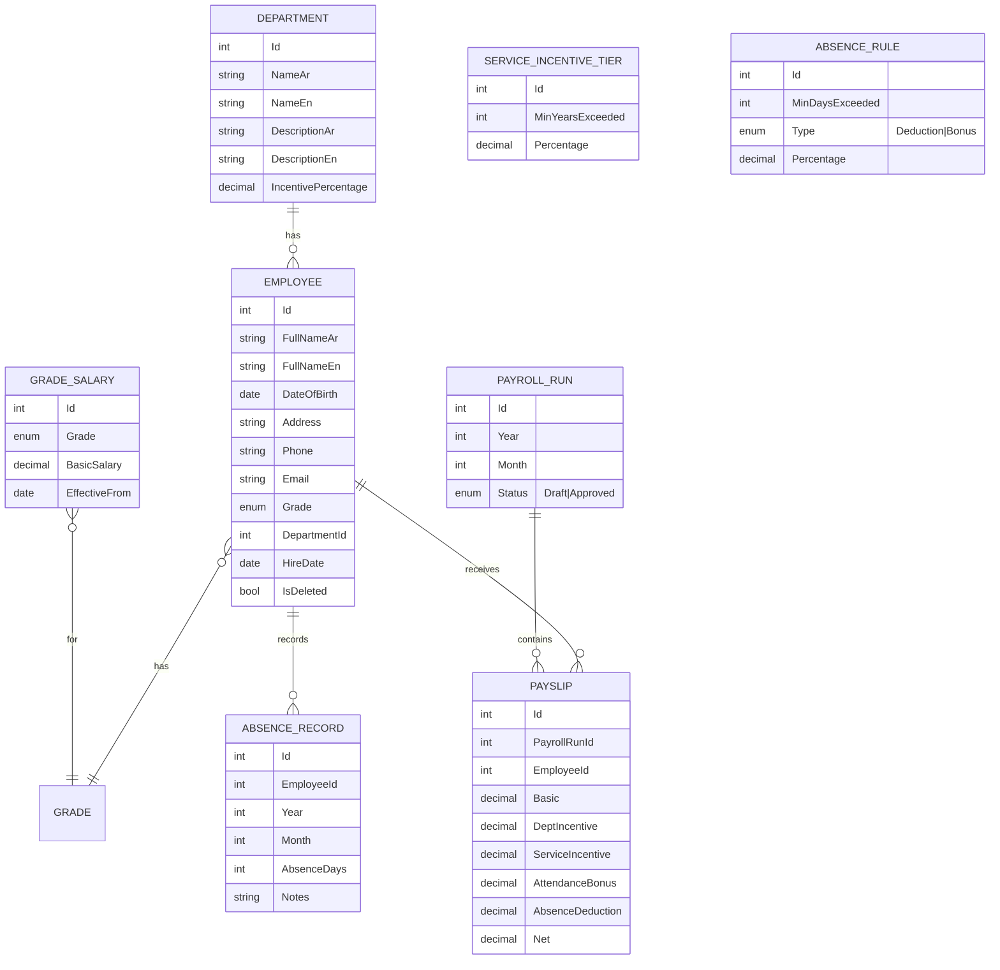

# Payroll System — Requirements Analysis

Source: [`Task-Payroll.pdf`](./Task-Payroll.pdf) (Arabic). This document translates, structures, and analyses the requirements, and lists the business rules and open questions that must be confirmed before or during implementation.

## 1. Scope

The system manages a company's employees and calculates their monthly salaries based on job grade, department incentive, years of service, and attendance (absence days). It consists of six modules:

| # | Module (EN) | Module (AR) |
|---|-------------|-------------|
| 1 | Employee Management | إدارة الموظفين |
| 2 | Salary Management | إدارة المرتبات |
| 3 | Department Management | إدارة الأقسام |
| 4 | Incentive Management | إدارة الحوافز |
| 5 | Attendance Management | إدارة الحضور والانصراف |
| 6 | Reports | إدارة التقارير |

## 2. Functional Requirements

### 2.1 Employee Management (إدارة الموظفين)

| ID | Requirement |
|----|-------------|
| EMP-01 | Add a new employee with: **Name (Arabic + English), Date of Birth, Address, Phone, Email, Job Grade, Department, Hire Date**. |
| EMP-02 | Edit employee data. |
| EMP-03 | View employees (list with search, filter by department/grade, paging; details view). |
| EMP-04 | Delete employees (soft delete, to keep payroll history intact). |

### 2.2 Salary Management (إدارة المرتبات)

| ID | Requirement |
|----|-------------|
| SAL-01 | Add salaries. |
| SAL-02 | Edit salaries. |
| SAL-03 | Salaries depend on the **job grade**: **First, Second, Third** (أولى – ثانية – ثالثة). |

Interpretation: a basic salary amount is defined **per job grade**; every employee inherits the basic salary of their grade. Changes are effective-dated so historical payrolls are not altered.

### 2.3 Department Management (إدارة الأقسام)

| ID | Requirement |
|----|-------------|
| DEP-01 | Add a department. |
| DEP-02 | Edit departments. |
| DEP-03 | Delete departments (blocked while employees are assigned). |
| DEP-04 | View departments. |

### 2.4 Incentive Management (إدارة الحوافز)

| ID | Requirement |
|----|-------------|
| INC-01 | **Department incentive**: each department has an incentive percentage applied to the salary. The percentage can be added and edited. |
| INC-02 | **Years-of-service incentive**: the longer the employee has worked at the company, the higher the incentive percentage. |
| INC-03 | Service tiers: employees who **exceeded 5 years** get a percentage, and those who **exceeded 7 years** get a (higher) percentage. Percentages can be added and edited. |

### 2.5 Attendance Management (إدارة الحضور والانصراف)

| ID | Requirement |
|----|-------------|
| ATT-01 | Record each employee's **absence days** (per month). |
| ATT-02 | Absence reduces the salary by a percentage; the more absence days, the higher the deduction. |
| ATT-03 | The manager can add and edit the deduction percentages at any time. |
| ATT-04 | Absence tiers: **more than 2 days**, **more than 5 days**, **more than 10 days**, **more than 15 days**. |
| ATT-05 | **One day or no absence** gives a **bonus** (not a deduction) with a percentage set and editable by the manager. |

### 2.6 Reports (إدارة التقارير)

| ID | Requirement |
|----|-------------|
| REP-01 | Attendance report. |
| REP-02 | Incentives and deductions report. |
| REP-03 | Company employees report. |
| REP-04 | Employees' salaries report. |

All reports: filter by month/year and department, view on screen, export to **PDF** and **Excel**, printable.

## 3. Business Rules

| ID | Rule |
|----|------|
| BR-01 | Job grades are a fixed set: `First`, `Second`, `Third`. |
| BR-02 | Basic salary = the active salary amount of the employee's grade for the payroll month. |
| BR-03 | Department incentive amount = Basic salary × department incentive %. |
| BR-04 | Years of service = full years between Hire Date and the last day of the payroll month. |
| BR-05 | Service incentive: only the **highest matching tier** applies (> 7 years overrides > 5 years). Not cumulative. |
| BR-06 | Absence tier is matched by the **highest threshold strictly exceeded** (e.g. 6 days → "> 5 days" tier). |
| BR-07 | 0 or 1 absence day → attendance bonus %. Exactly 2 days → no bonus and no deduction. |
| BR-08 | All percentages are applied to the **basic salary**. |
| BR-09 | Net salary = Basic + Department incentive + Service incentive + Attendance bonus − Absence deduction. Never below 0. |
| BR-10 | Percentages are between 0 and 100. Tiers must be unique and ordered. |
| BR-11 | Once a monthly payroll is **approved**, its values are frozen (snapshot); later rate changes do not affect it. |
| BR-12 | Hire date cannot be in the future; employee must be at least 18 years old at hire date; email unique. |

### Worked example

Employee in grade *Second* (basic 8,000), department *IT* (incentive 10%), 6 years of service (tier "> 5 years" = 5%), 3 absence days (tier "> 2 days" = 2%):

```
Basic                 =  8,000
Department incentive  =  8,000 × 10% =   800
Service incentive     =  8,000 ×  5% =   400
Attendance bonus      =                    0
Absence deduction     =  8,000 ×  2% =  (160)
Net salary            =  9,040
```

## 4. Domain Model (initial)



## 5. Non-Functional Requirements

| ID | Requirement |
|----|-------------|
| NFR-01 | **Bilingual system: Arabic (RTL, default) and English (LTR)** — see §5.1. |
| NFR-02 | Authentication with JWT; roles **Admin** (manager: rates, approvals, users) and **HR** (employees, attendance, reports). |
| NFR-03 | Responsive UI (desktop first, usable on tablet). |
| NFR-04 | Audit fields (CreatedBy/At, UpdatedBy/At) on all entities. |
| NFR-05 | Money stored as `decimal(18,2)`; rounding half away from zero to 2 decimals. |
| NFR-06 | Unit test coverage ≥ 80% for the payroll calculation; integration tests for all API endpoints. |
| NFR-07 | Dockerised; CI on GitHub Actions (build, test, lint). |
| NFR-08 | API documented with OpenAPI. |

### 5.1 Localization (Arabic / English)

The whole system is bilingual. Arabic is the default language; the user can switch at any time and the choice is saved per user.

| ID | Requirement |
|----|-------------|
| L10N-01 | **UI**: every label, menu, button, message, validation error, and empty state is available in Arabic and English; no hard-coded text. |
| L10N-02 | **Layout direction**: Arabic renders RTL and English LTR, switched at runtime without reload (Material components, tables, dialogs, date pickers, icons such as arrows mirrored). |
| L10N-03 | **Bilingual master data**: department name/description and employee full name are stored in both languages (`NameAr` / `NameEn`). Arabic is required; English is optional and falls back to Arabic when it is empty. |
| L10N-04 | **Enums/lookups** (job grade First/Second/Third = أولى/ثانية/ثالثة, absence rule types, payroll status) are translated, never shown as raw codes. |
| L10N-05 | **API**: the client sends `Accept-Language: ar` or `en`; validation and error messages (`ProblemDetails`) are returned in that language; DTOs return the localized `name` plus `nameAr` / `nameEn` for editing. |
| L10N-06 | **Formatting**: dates, numbers, currency, and percentages follow the active locale (`ar-EG` / `en-US`); Western (0-9) digits by default, with Arabic-Indic digits as a configurable option. Dates are stored in a culture-independent format. |
| L10N-07 | **Reports** (screen, PDF, Excel) are generated in the selected language with RTL layout and an Arabic-capable font for Arabic. |
| L10N-08 | **Search** finds employees and departments by both Arabic and English names; Arabic search normalises letter variants (أ/إ/آ→ا, ة→ه, ى→ي). |
| L10N-09 | User's preferred language is saved on the user profile (`PreferredLanguage`) and applied after login. |

## 6. Open Questions (to confirm with the stakeholder)

1. Are percentages applied to the **basic salary** (assumed) or to the gross after incentives?
2. Is the service incentive **cumulative** (5-year % + 7-year %) or only the highest tier (assumed)?
3. "More than 2 days" — is exactly **2 days** neutral (assumed), or should it be the first deduction tier?
4. Is "one day or none" bonus applied to **0 and 1** day (assumed)?
5. Is absence recorded as a **monthly total** (assumed) or as individual dated entries (daily attendance)? The design supports monthly totals first; daily check-in/out can be added later.
6. Can an employee have an individual salary different from the grade amount? (Assumed no.)
7. Currency and number of payroll cycles per month (assumed one monthly cycle, single currency).
8. Should deleting an employee be a hard delete? (Assumed soft delete to keep history.)
