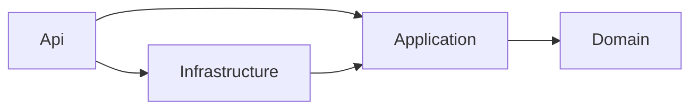

# Payroll System — Technical Architecture

## 1. Technology Stack

| Layer | Technology |
|-------|------------|
| Backend | **.NET 10 (LTS)**, ASP.NET Core Web API (controllers), C# 14 |
| ORM / DB | Entity Framework Core 10, **SQL Server 2022** (Docker for dev) |
| Auth | ASP.NET Core Identity + JWT bearer (access + refresh tokens) |
| Validation | FluentValidation |
| Application pattern | Clean Architecture + CQRS (MediatR) |
| Mapping | Mapster (or manual mapping) |
| Logging | Serilog (console + file / Seq) |
| Reports | QuestPDF (PDF), ClosedXML (Excel) |
| API docs | OpenAPI (`Microsoft.AspNetCore.OpenApi`) + Scalar UI |
| Tests (BE) | xUnit, FluentAssertions, NSubstitute, Testcontainers (SQL Server), `WebApplicationFactory` |
| Frontend | **Angular (latest stable)**, standalone components, **Signals**, new control flow (`@if`, `@for`), zoneless change detection |
| UI kit | Angular Material + CDK (RTL support via `Directionality`) |
| i18n | `@ngx-translate/core` (runtime switch Arabic/English) |
| Forms | Typed Reactive Forms |
| Charts | ng2-charts / Chart.js (dashboard) |
| Tests (FE) | Vitest/Jest (unit), Playwright (E2E) |
| Lint / format | ESLint (angular-eslint), Prettier, `dotnet format` |
| DevOps | Docker, docker-compose, GitHub Actions |

## 2. Solution Structure

```
payroll-system/
├── backend/
│   ├── Payroll.sln
│   ├── src/
│   │   ├── Payroll.Domain/            # Entities, enums, value objects, domain services (PayrollCalculator)
│   │   ├── Payroll.Application/       # CQRS commands/queries, DTOs, validators, interfaces
│   │   ├── Payroll.Infrastructure/    # EF Core DbContext, configurations, migrations, Identity, reports
│   │   └── Payroll.Api/               # Controllers, middleware, DI, auth, OpenAPI
│   └── tests/
│       ├── Payroll.Domain.Tests/
│       ├── Payroll.Application.Tests/
│       └── Payroll.Api.IntegrationTests/
├── frontend/
│   └── payroll-web/                   # Angular app
│       └── src/app/
│           ├── core/                  # auth, interceptors, guards, layout, i18n
│           ├── shared/                # reusable components, pipes, directives
│           └── features/
│               ├── dashboard/
│               ├── employees/
│               ├── departments/
│               ├── salaries/
│               ├── incentives/
│               ├── attendance/
│               ├── payroll/
│               └── reports/
├── docs/
├── docker-compose.yml
└── .github/workflows/
```

## 3. Backend Design

### 3.1 Layers & dependencies



### 3.2 Payroll calculation (domain service)

```csharp
public sealed class PayrollCalculator
{
    public PayslipBreakdown Calculate(PayrollInput input)
    {
        var basic        = input.GradeBasicSalary;
        var dept         = Percent(basic, input.DepartmentIncentivePct);
        var service      = Percent(basic, MatchServiceTier(input.YearsOfService)?.Percentage ?? 0);
        var rule         = MatchAbsenceRule(input.AbsenceDays);
        var bonus        = rule?.Type == AbsenceRuleType.Bonus     ? Percent(basic, rule.Percentage) : 0;
        var deduction    = rule?.Type == AbsenceRuleType.Deduction ? Percent(basic, rule.Percentage) : 0;
        var net          = Math.Max(0, basic + dept + service + bonus - deduction);
        return new(basic, dept, service, bonus, deduction, net);
    }
}
```

### 3.3 REST API (v1)

| Resource | Endpoints |
|----------|-----------|
| Auth | `POST /api/v1/auth/login`, `POST /auth/refresh`, `POST /auth/logout`, `GET /auth/me` |
| Users | `GET/POST/PUT/DELETE /api/v1/users` (Admin) |
| Departments | `GET /departments`, `GET /departments/{id}`, `POST`, `PUT /{id}`, `DELETE /{id}`, `PUT /{id}/incentive` |
| Employees | `GET /employees?search=&departmentId=&grade=&page=&pageSize=&sort=`, `GET /{id}`, `POST`, `PUT /{id}`, `DELETE /{id}` |
| Grade salaries | `GET /grade-salaries`, `GET /grade-salaries/history?grade=`, `POST`, `PUT /{id}` |
| Service incentive tiers | `GET/POST/PUT/DELETE /incentives/service-tiers` |
| Absence rules | `GET/POST/PUT/DELETE /attendance/rules` |
| Absence records | `GET /attendance/records?year=&month=&departmentId=`, `PUT /attendance/records` (bulk upsert), `GET /attendance/records/{employeeId}` |
| Payroll | `POST /payroll/runs` (generate draft), `GET /payroll/runs`, `GET /payroll/runs/{id}`, `POST /payroll/runs/{id}/recalculate`, `POST /payroll/runs/{id}/approve`, `GET /payroll/preview/{employeeId}?year=&month=` |
| Reports | `GET /reports/{attendance|incentives-deductions|employees|salaries}?year=&month=&departmentId=&format=json|pdf|xlsx` |
| Dashboard | `GET /dashboard/summary` |

Conventions: RFC 7807 `ProblemDetails` for errors, paged responses `{ items, page, pageSize, totalCount }`, `ETag`/rowversion for optimistic concurrency.

## 4. Frontend Design

- Lazy-loaded feature routes, `authGuard` + `roleGuard`.
- HTTP interceptors: JWT attach, refresh on 401, global error → snackbar, loading indicator.
- State: signal-based stores per feature (`signal`, `computed`, `resource`/`rxResource`).
- Generic `DataTableComponent` (Material table + paginator + sort), `ConfirmDialogComponent`, `PageHeaderComponent`.
- Layout: side nav + toolbar, language switch toggles `dir="rtl"` and Material `Directionality`.

## 5. Localization (Arabic / English)

| Concern | Backend | Frontend |
|---------|---------|----------|
| Language selection | `RequestLocalizationMiddleware` (supported: `ar`, `en`; default `ar`) reading `Accept-Language` | `LanguageService` (signal) → sets `<html lang dir>`, CDK `Directionality`, ngx-translate, `LOCALE_ID`-aware pipes, `MAT_DATE_LOCALE`; sends `Accept-Language` via interceptor |
| Static text | `.resx` resources (`SharedResource.ar.resx` / `.en.resx`) for validation and error messages; FluentValidation `WithMessage(localizer[...])` | `assets/i18n/ar.json`, `en.json`; ESLint/CI check for missing keys between both files |
| Bilingual data | Owned value object `LocalizedText { Ar, En }` mapped to `NameAr` / `NameEn` columns; `Localize()` helper returns `En ?? Ar` for English requests | Forms show two inputs (Arabic `dir="rtl"`, English `dir="ltr"`); tables show the localized `name` |
| Enums | Resource keys `Enum.JobGrade.First` etc. | `translateEnum` pipe |
| Formatting | `CultureInfo` from request for reports | `registerLocaleData(localeAr)`; `DatePipe` / `DecimalPipe` / `CurrencyPipe` with active locale |
| Styling | — | CSS logical properties only (`margin-inline-start`, `padding-inline-end`, `inset-inline-start`); `[dir=rtl]` mirroring for directional icons |
| Reports | QuestPDF `ContentDirection(RightToLeft)` + Cairo / Noto Naskh Arabic font; ClosedXML `RightToLeft = true` sheets | Download in current language |
| Search | Normalised Arabic search columns (`SearchKey` computed: remove diacritics, unify أ/إ/آ/ا, ة/ه, ى/ي) | — |
| User preference | `AppUser.PreferredLanguage` | Applied after login, toggle in toolbar |

## 6. Security

- Password policy, lockout after 5 failed attempts.
- Role-based authorization policies: `AdminOnly`, `HrOrAdmin`.
- CORS restricted to the frontend origin; HTTPS only; secrets via user-secrets / environment variables.

## 7. Environments

| Env | Notes |
|-----|-------|
| Local | `docker compose up` (SQL Server + API + Web) |
| CI | GitHub Actions: build, test, lint, Docker image build |
| Staging/Prod | Container registry (GHCR) → Azure App Service / any Docker host |
