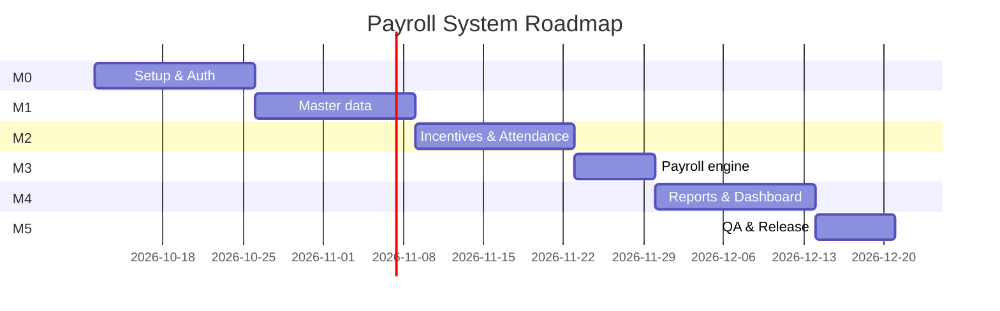

# Payroll System — Implementation Plan

Stack: **.NET 10 (LTS) Web API** + **Angular (latest stable)** + SQL Server. The system is **bilingual (Arabic RTL default / English LTR)** across UI, data, API messages and reports. See [Analysis](./01-ANALYSIS.md) and [Architecture](./02-ARCHITECTURE.md).

All work is tracked as GitHub issues: one **Epic** per module, broken into **Tasks** (each task is one pull request). Milestones map to the phases below.

## 1. Phases & Milestones

| Milestone | Goal | Duration | Epics |
|-----------|------|----------|-------|
| **M0 – Project Setup** | Repo, solution skeletons, DB, CI, Docker, auth | Week 1–2 | E01 Setup, E02 Auth |
| **M1 – Master Data** | Departments, grade salaries, employees (CRUD) | Week 3–4 | E03 Departments, E04 Salaries, E05 Employees |
| **M2 – Incentives & Attendance** | Configurable incentive & absence rules, monthly absence entry | Week 5–6 | E06 Incentives, E07 Attendance |
| **M3 – Payroll Engine** | Calculation, monthly payroll runs, payslips, approval | Week 7 | E08 Payroll |
| **M4 – Reports & Dashboard** | 4 reports with PDF/Excel export, dashboard | Week 8–9 | E09 Reports |
| **M5 – QA & Release** | Integration/E2E tests, hardening, docs, deployment | Week 10 | E10 QA & Release |

## 2. Work Breakdown (Epics → Tasks)

| Epic | Tasks |
|------|-------|
| **E01 Project Setup & Infrastructure** | Repo conventions · .NET solution scaffold · EF Core + base entities · Backend cross-cutting · **Backend localization (AR/EN)** · Angular scaffold · Angular core shell & i18n (RTL/LTR) · Docker · CI |
| **E02 Authentication & Authorization** | Identity + JWT API · User management API · Login & guards (FE) · User management UI |
| **E03 Department Management** | Department CRUD API · Department screens |
| **E04 Salary Management** | Grade salary API (effective-dated) · Grade salary screens |
| **E05 Employee Management** | Employee CRUD API · Employee list UI · Employee form & details UI |
| **E06 Incentive Management** | Department incentive API · Service tiers API · Incentive settings UI |
| **E07 Attendance Management** | Absence rules API · Monthly absence records API · Absence rules UI · Monthly attendance grid UI |
| **E08 Payroll Calculation** | PayrollCalculator domain service · Payroll runs & payslips API · Payroll preview API · Payroll UI |
| **E09 Reports & Dashboard** | Report export infra · 4 report endpoints · Reports UI · Dashboard |
| **E10 QA, Hardening & Release** | API integration tests · E2E tests · Security & performance · Documentation · Release pipeline |

## 3. Definition of Done (every task)

- [ ] Code follows conventions; `dotnet format` / ESLint / Prettier pass.
- [ ] Unit tests added/updated and passing; CI is green.
- [ ] API endpoints documented in OpenAPI with examples; errors return `ProblemDetails`.
- [ ] **Bilingual**: all UI strings exist in both `ar.json` and `en.json`; server messages exist in both `.resx` files; bilingual data fields (`*Ar` / `*En`) handled; screens verified in Arabic (RTL) and English (LTR).
- [ ] Validation exists on both client and server.
- [ ] PR reviewed and merged into `develop`, linked issue closed.

## 4. Git Workflow

- Branches: `main` (releases), `develop` (integration), `feature/<issue-number>-<slug>`, `fix/<issue-number>-<slug>`.
- Conventional Commits (`feat:`, `fix:`, `chore:`, `test:`, `docs:`), PR title references the issue (`Closes #12`).
- Squash merge; branch protection on `main` and `develop` (CI required).

## 5. Labels

| Label | Meaning |
|-------|---------|
| `type:epic`, `type:task` | Issue kind |
| `area:backend`, `area:frontend`, `area:devops`, `area:qa`, `area:docs` | Technical area |
| `module:employees`, `module:salaries`, `module:departments`, `module:incentives`, `module:attendance`, `module:payroll`, `module:reports`, `module:auth`, `module:core` | Business module |
| `priority:high`, `priority:medium`, `priority:low` | Priority |
| `i18n` | Involves Arabic/English localization work |

## 6. Risks

| Risk | Mitigation |
|------|------------|
| Ambiguous business rules (see Analysis §6) | Rules are configurable data, not code; confirm open questions in M0 |
| Rate changes corrupting history | Effective-dated salaries + frozen payslip snapshots on approval |
| RTL layout issues | Use Material + logical CSS properties (`margin-inline-start`), test both directions in E2E |
| Report rendering of Arabic text in PDF | QuestPDF with an Arabic-capable font (e.g. Cairo / Noto Naskh Arabic) and RTL text direction |
